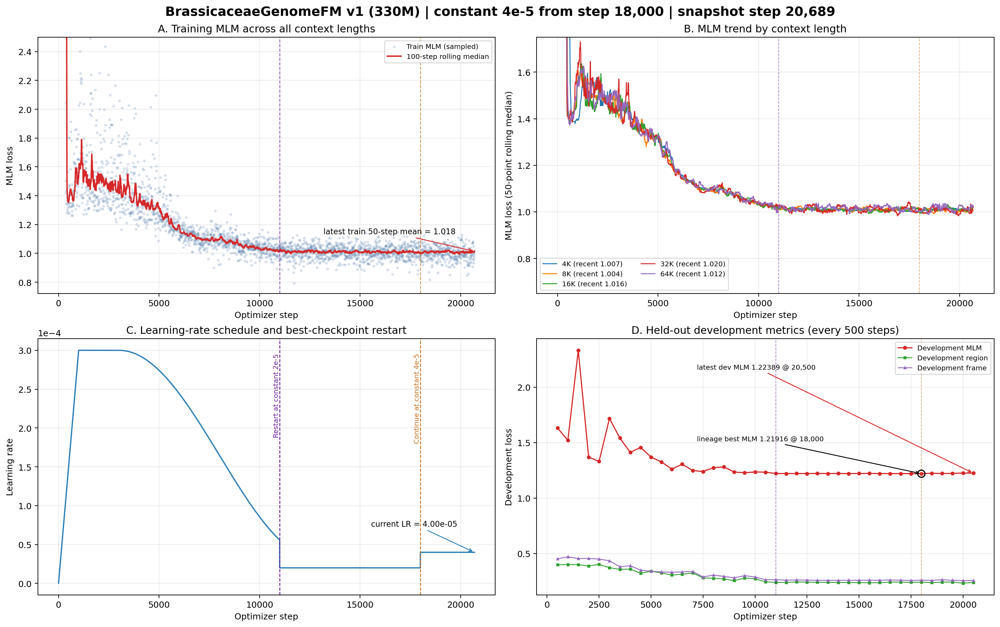
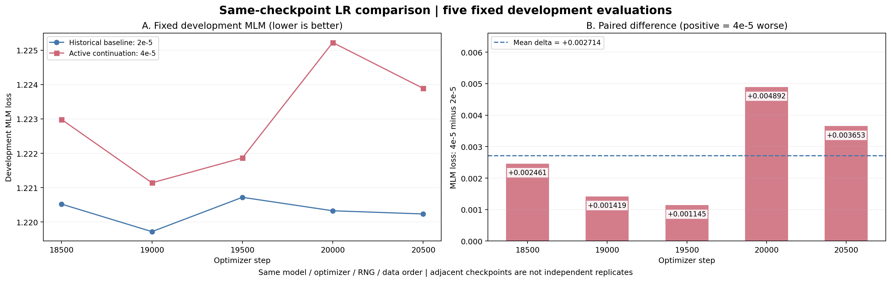

# BrassicaceaeGenomeFM — 十字花科基因组基础模型

## 当前状态

| 项目 | 状态 |
|------|------|
| 模型 | BrassiCaduceus ~330M（Bi-Mamba2 + tied embedding） |
| 训练 | **运行中** — 当前4e-5分支从step 18,000完整恢复，快照至step 20,689 |
| 学习率 | 从step 18,001起恒定4e-5；无warmup、衰减、自动重启或开发集触发回退 |
| 持续运行策略 | 用户已明确保持使用4e-5；取消20,500步停试，不自动切回2e-5，无预设结束步数 |
| 开发集 MLM | 当前4e-5分支已有5次评估；分支最低1.221141 @ 19,000，最新1.223888 @ 20,500；越低越好 |
| 活跃lineage最低值 | 1.219156 @ 18,000，属于2e-5父checkpoint，不是4e-5的新结果 |
| 固定五点对照 | 4e-5在五个点均比同阶段2e-5损失更高；均值相对高0.222%，尚无收益证据 |
| 语料覆盖 | 162.7亿 / 1142亿唯一tokens（14.25%）；cycle 0、复用0；不是训练完成度 |
| Checkpoint | 4e-5分支已永久保存5份完整checkpoint，最新step 20,500；最新状态文件SHA-256重算通过 |
| 原2e-5分支 | 完整保留在step 23,000，当前暂停，不覆盖也不自动恢复 |
| GPU | 原三张A100 40GB、原三个FSDP rank持续运行；核查时显存约31GiB/卡，多次采样见100%计算利用率，step继续前进 |
| 验证 | 4e-5启动时342项训练测试和14项原控制器CPU测试通过；真实GPU启动验收通过。此次为状态/绘图定向验证，不是重跑训练全套测试 |
| 下游任务 | 32项任务；6项已有12个冻结release（521,204样本），正式结果仍为0 |
| 当前可执行范围 | 冻结release可展开57次现有方法运行；完整864-cell矩阵仍有536项实现阻塞 |
| 公共基线 | 14个公共DNA-FM权重已就位；权重就位不等于适配器和正式评测完成 |

## 关键参数

- 架构：21层 Bi-Mamba2, d_model=768, d_state=128, group_size=6
- 并行：FSDP (FULL_SHARD), 3 GPU, world_size=3
- 精度：bfloat16 参数+激活, float32 残差累积
- 优化器：完整恢复原2e-5分支step 18,000的AdamW状态；从step 18,001起恒定4e-5
- 每 step token 数：786,432
- gradient_accumulation=4, per_rank microbatch: 16/8/4/2/1 (4K→64K)
- RC 仅在 4K–64K 启用, fraction=0.05

## 损失函数

| 损失 | 权重 | 说明 |
|------|------|------|
| MLM | 1.0 | 15% 掩码, span+singleton |
| Region | 0.25 | 9类基因组区域分类 |
| Frame | 0.1 | 6-frame ORF 检测 |
| Boundary | 0.1 | 区域边界 token 检测 |
| RC | 0.05 | 反向互补一致性 |
| Homeolog | 0.05 | 同源基因对 InfoNCE |

## 训练进度（恒定4e-5，快照至step 20,689）

状态与曲线快照：2026-09-09 09:25（北京时间）。最新开发集评估为step 20,500；实时训练继续前进，不追改已经冻结的图表。

[训练曲线PDF](docs/brassicaceae_genomefm_v1_training_curves_step20689.pdf) · [机器可读摘要与五点精确数值](docs/training_summary_v1.json)

### 训练总览：逐图怎么看

**A. 全部上下文训练MLM（左上）**
横轴是优化步数，纵轴是掩码预测损失，越低越好。浅蓝点是抽样单步值，红线是100步滚动中位数。当前4e-5分支已连续运行2,689步，最近50步训练MLM均值1.018。曲线未见持续失控，但训练拟合不能替代开发集表现。纵轴聚焦后期范围，未展示全部早期高损失峰值。

**B. 五档上下文（右上）**
横轴是优化步数，五色对应4K–64K上下文，各用同长度最近50个点的滚动中位数平滑。图例最近50点均值为4K 1.007、8K 1.004、16K 1.016、32K 1.020、64K 1.012。五档均实际运行；不同长度样本组成不同，不能据较低训练损失宣称长程能力更强。

**C. 学习率与分支边界（左下）**
紫线step 11,000表示从原始checkpoint恢复后改用2e-5；橙线step 18,000表示从该父checkpoint完整恢复后改用4e-5。模型、AdamW、五档采样进度、pair cursor、token账本和三份rank随机状态一并恢复。当前恒定4e-5，没有预热、衰减或自动降回规则。20,500仅为原定比较窗口终点，不再是停训点。

**D. 固定开发集（右下）**
横轴为每500步的固定评估，纵轴为损失；红色是MLM，绿色是区域分类，紫色是阅读框预测。黑圈的1.219156 @ 18,000是继承的父checkpoint最低值；当前4e-5最新为1.223888 @ 20,500，没有刷新最低值。总览纵轴不能清楚呈现微小差异，应结合下面的放大对照图和数值表。

## 2e-5与4e-5：五个固定开发集点

两条轨迹同从step 18,000完整checkpoint出发，只改变学习率；比较前已冻结2e-5参照轨迹。已核对全部2,500步的上下文、采样状态、有效计数和token账本，以及五个评估点的有效样本数与评估token预算。没有挑选表现有利的checkpoint。

[对照图PDF](docs/brassicaceae_genomefm_v1_lr_comparison_step20500.pdf) · 精确来源数值见摘要中的`fixed_lr_comparison.pairs`。

| checkpoint step | 原2e-5开发集MLM | 当前4e-5开发集MLM | 4e-5减2e-5 |
|---|---|---|---|
| 18,500 | 1.220523 | 1.222984 | +0.002461 |
| 19,000 | 1.219722 | 1.221141 | +0.001419 |
| 19,500 | 1.220719 | 1.221864 | +0.001145 |
| 20,000 | 1.220328 | 1.225220 | +0.004892 |
| 20,500 | 1.220236 | 1.223888 | +0.003653 |
| 五点均值 | 1.220306 | 1.223019 | +0.002714 |

**对照图A（左）：看绝对损失。** 横轴是相同步数，纵轴是开发集MLM，越低越好；蓝线为历史2e-5对照，粉线为当前4e-5。纵轴放大了小幅差异，不能把视觉间距当作巨大提升或退化。五点中4e-5均更高。

**对照图B（右）：看配对差值。** 横轴为相同五个checkpoint，纵轴为4e-5减2e-5；0表示持平，正值表示4e-5更差。柱形从0起，虚线是平均差值+0.002714；对应均值相对高0.222%。它表示这段固定窗口的数值差异，不是统计显著性检验。

### 当前判断与边界

- 当前4e-5分支已有5次评估，均值1.223019，范围1.221141–1.225220。最新值仍高于分支最低值和父checkpoint最低值；目前没有提高学习率带来收益的证据。
- 相邻checkpoint不是独立随机重复；没有多seed证据，也没有正式下游分数。不能把这段比较外推为下游能力显著变化。
- **继续4e-5是用户明确选择的运行策略，不是根据结果自动选出的赢家。** 2026-09-08已停用原有界控制器，不自动切回2e-5，也不因开发集暂时变差自动降学习率。训练rank未重启或回退；原2e-5分支保持step 23,000暂停状态。
- 5份checkpoint的manifest、receipt和文件大小核对通过；最新step 20,500完整状态SHA-256重新计算通过。每500步永久保存策略未变。

### 活跃lineage与历史对照

权威曲线只包含：原始run的step 1–11,000 → 2e-5分支step 11,001–18,000 → 当前4e-5分支step 18,001以后。原2e-5分支18,000之后的历史只用于单独对照，不进入活跃训练总览。此次快照步数低于上次2e-5快照，是因为换用了从18,000恢复的子分支，不是丢失原分支训练记录。

原始追加日志中曾有step 8,501–8,994的恢复重跑记录；总览取每步最后一次有效记录，省略494条被后续重跑替代的旧记录，避免重复计步。所有原始日志与checkpoint均保留，未作改写。

## 下游评测状态

- Registry共32项任务、27种方法，完整矩阵为864个task×method单元：154个实现层面ready、536个blocked、174个not applicable。
- 只有P1/P3/P4/P8/P10/P13六项任务具备冻结数据，共12个release、521,204个样本；其余26项任务尚未冻结正式数据。
- 12个release按当前可用方法可展开57次真实运行；这些运行尚未启动，当前没有正式下游分数或排行榜。
- 14个公共DNA基础模型权重已统一保存在`~/myhermes/down_model`。多数公共模型适配器/真实forward闭环仍未完成，不能把“权重已下载”写成“公共基线已跑完”。
- BrassicaceaeGenomeFM的正式下游CPU合同为q03；下游GPU必须等用户指定执行卡，不占用当前三卡预训练任务。

## 本地运行与产物入口

- 当前训练日志：`workspace/formal_runs/brassicaceae_330m_constant4e5_from_step18000_trial_v1/training.jsonl`
- 当前checkpoint：`workspace/formal_runs/brassicaceae_330m_constant4e5_from_step18000_trial_v1/checkpoints/`
- 当前运行策略：`workspace/experiments/lr_2e5_vs4e5_step18000_v1/continuation_v2/active_policy.json`
- 4e-5 CPU Gate：`workspace/release/formal_cpu_gate_constant4e5_from_step18000_trial_v1/`
- 训练已经持续运行；不要重复执行历史启动命令。旧有界试验授权与控制器只作历史保留，不再是当前停止/恢复策略。
- GitHub仅发布轻量说明、PNG/PDF曲线和摘要；不上传checkpoint、训练日志、原始数据、公共模型权重或完整评测目录。此次更新不修改训练代码、学习率或GPU进程。

## 训练集

- 66个十字花科genome assembly，cluster-aware训练/开发集划分。
- 当前cycle 0，不放回抽样；覆盖比例不是训练完成度。
- 五档上下文的token比例：4K=10%、8K=20%、16K=21%、32K=27%、64K=22%。
